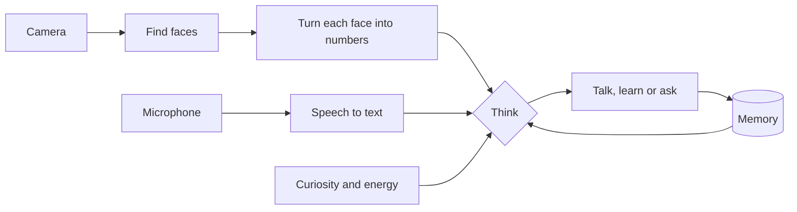

# The Machine

An AI that watches through your webcam, listens, talks, and learns from you.

It starts knowing nothing. You show it your face and tell it your name. You hold up a cup and say "this is a cup". Next time, it knows. It keeps everything it learns, even after you close it.

Inspired by Chappie (2015) and The Machine from Person of Interest.

```
you:      my name is Farhan
machine:  Farhan. You are the first person I know.
you:      this is a cup
machine:  Cup. Got it.

(the next day)

machine:  Hello Farhan.
you:      what is this?
machine:  This is a cup.
```

## What makes it different

- **It learns while it runs.** No training step, no dataset. You teach it by talking to it.
- **It does not forget.** Learning a new person never erases an old one.
- **It runs offline.** Nothing leaves your computer. No GPU or internet needed after setup.
- **It is small.** The models are about 39 MB and it uses about 5% of one CPU core.

## Install

Needs Python 3.10 to 3.13.

```bash
git clone https://github.com/svviitzerland/The-Machine.git
cd The-Machine
pip install -e ".[ears,voice]"
python -m the_machine download
python -m the_machine run
```

No microphone? Run `python -m the_machine run --no-mic` and type instead.

## How to teach it

| Say this | What happens |
|---|---|
| `my name is Farhan` | It learns your face. The first person becomes its owner. |
| `this is my friend Sam` | It learns the other face in view. |
| `this is a cup` | It learns the object in the middle of the camera. |
| `coffee is a drink` | It remembers a fact. |
| `who am I?` / `what is this?` | It answers from what it learned. |
| `yes` / `no, it's a plate` | It strengthens or corrects its last answer. |
| `forget Sam` | It deletes Sam completely. Only the owner can do this. |
| `go to sleep` | It organizes its memory. |

## How it works



1. **See.** It finds faces in the camera and turns each one into a list of numbers.
2. **Remember.** It compares those numbers with the people it knows. If nothing is close enough, it says it does not know you and asks.
3. **Think.** Everything it sees and hears competes for attention. The most important thing wins, and it acts on that.
4. **Sleep.** When its energy runs low, it sleeps. It reviews the day, checks what it taught itself against what you taught it, throws away what does not fit, forgets unimportant things, and notices people it keeps seeing but does not know yet.

All memory is one file at `data/machine.db`. Delete it and the Machine starts over.

## Evaluation

The `eval/` folder tests the memory on real faces from [LFW](https://vis-www.cs.umass.edu/lfw/), using the same code the Machine runs.

```bash
pip install -e ".[eval]"
python eval/embed_lfw.py              # embed LFW with YuNet + SFace
python eval/embed_lfw.py --degrade    # same, as if seen across a room
python eval/experiments.py            # 10 seeds, about 2 minutes
```

## Commands

| Command | What it does |
|---|---|
| `run` | Start with camera, microphone and voice |
| `chat` | Text only, no camera |
| `status` | Show what it knows |
| `sleep` | Organize memory now |
| `bench` | Measure speed and memory use on your computer |
| `reset` | Erase all memory |

## Speed

Measured on an Apple laptop CPU with `python -m the_machine bench`:

| Step | Time |
|---|---|
| Find faces in one frame | 1.7 ms |
| Read one face | 3.6 ms |
| Search 100,000 memories | 0.9 ms |
| One sleep cycle | 0.16 s |

Run `bench` on your own machine to get your numbers.

## Language

English for now. Each language is one file in `the_machine/language/packs/`. To add one, copy `en.py` and translate it.

## Privacy

- Runs fully offline after `download`.
- Stores faces as numbers, not photos.
- Only the owner can make it forget someone, and forgetting really deletes the data.

## Citation

A paper is in preparation. Until then, please cite:

```bibtex
@software{aulianda2026themachine,
  title  = {The Machine: An Offline AI That Learns From You},
  author = {Aulianda, Farhan},
  year   = {2026},
  url    = {https://github.com/svviitzerland/The-Machine}
}
```

## Contributing

Issues and pull requests are welcome, especially tests on Raspberry Pi and new language packs. Use [Conventional Commits](https://www.conventionalcommits.org/) and make sure `pytest` passes.

## License

Apache-2.0
