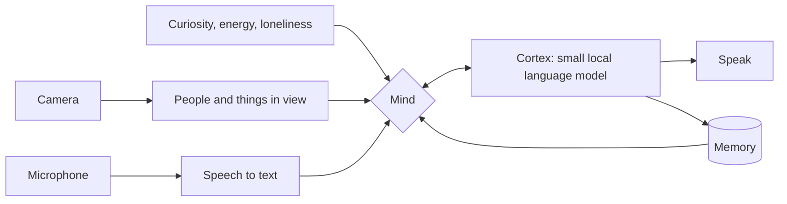

# The Machine

An AI that watches through your webcam, listens, talks, and learns from you.

It starts knowing nothing. It sees the people and things around it, wonders about them, and asks. Tell it who you are or what something is, in your own words, and it remembers. It keeps everything it learns, even after you close it.

Inspired by Chappie (2015) and The Machine from Person of Interest.

## What makes it different

- **It learns while it runs.** No training step, no dataset. You teach it by talking to it.
- **It does not forget.** Learning a new person never erases an old one.
- **It has a mind of its own.** It notices people coming and going, gets curious, gets tired, and speaks up when it wants to.
- **It runs offline.** Nothing leaves your computer after setup.

## Install

Needs Python 3.10 to 3.13.

```bash
git clone https://github.com/svviitzerland/The-Machine.git
cd The-Machine
pip install -e ".[all]"
python -m the_machine download   # once: eyes, ears, voice and brain
python -m the_machine run
```

No microphone? Run `python -m the_machine run --no-mic` and type to it on the page.

`run` opens a page in your browser where you watch what it sees, talk to it, and look inside its mind: its memory as a map and its neural network, which you can zoom, move and hover. To look inside while it is not running, use `python -m the_machine mind`.

## How it works



1. **See.** It finds faces and things in the camera and turns each one into a list of numbers. It compares those numbers with what it knows, and knows when it doesn't know.
2. **Think.** Everything it sees, hears and feels competes for attention. What wins goes to the cortex, a small language model running on your computer, together with what it remembers.
3. **Act.** The cortex decides what to say and what to learn. It can only store a name that someone really said, so a guess never becomes a memory.
4. **Sleep.** When its energy runs low, it sleeps. It reviews the day, checks what it taught itself against what you taught it, throws away what does not fit, forgets unimportant things, and notices people it keeps seeing but does not know yet.

All memory is one file at `data/machine.db`. Delete it and the Machine starts over.

## Evaluation

The `eval/` folder tests the memory on real faces from [LFW](https://vis-www.cs.umass.edu/lfw/), using the same code the Machine runs, and compares language models for the cortex.

```bash
pip install -e ".[eval]"
python eval/embed_lfw.py              # embed LFW with YuNet + SFace
python eval/embed_lfw.py --degrade    # same, as if seen across a room
python eval/experiments.py            # 10 seeds, about 2 minutes
python eval/cortex_eval.py models/<model>.gguf
```

## Commands

| Command | What it does |
|---|---|
| `run` | Start with camera, microphone and voice |
| `chat` | Text only, no camera |
| `mind` | Look inside: its memory and its neural network |
| `status` | Show what it knows |
| `sleep` | Organize memory now |
| `bench` | Measure speed and memory use on your computer |
| `reset` | Erase all memory |

## Privacy

- Runs fully offline after `download`.
- Stores faces and things as numbers, not photos.
- Only the person who made it can make it forget someone, and forgetting really deletes the data.

## Citation

A paper is in preparation. Until then, please cite:

```bibtex
@software{aulianda2026themachine,
  title  = {The Machine: An Offline AI That Learns From You},
  author = {Aulianda, Farhan},
  year   = {2026},
  url    = {https://github.com/svviitzerland/The-Machine}
}
```

## Contributing

Issues and pull requests are welcome, especially tests on Raspberry Pi. Use [Conventional Commits](https://www.conventionalcommits.org/) and make sure `pytest` passes.

## License

Apache-2.0. The default brain model, LFM3-1.7B, comes under the [LFM Open License](https://huggingface.co/LiquidAI/LFM3-1.7B-GGUF).
